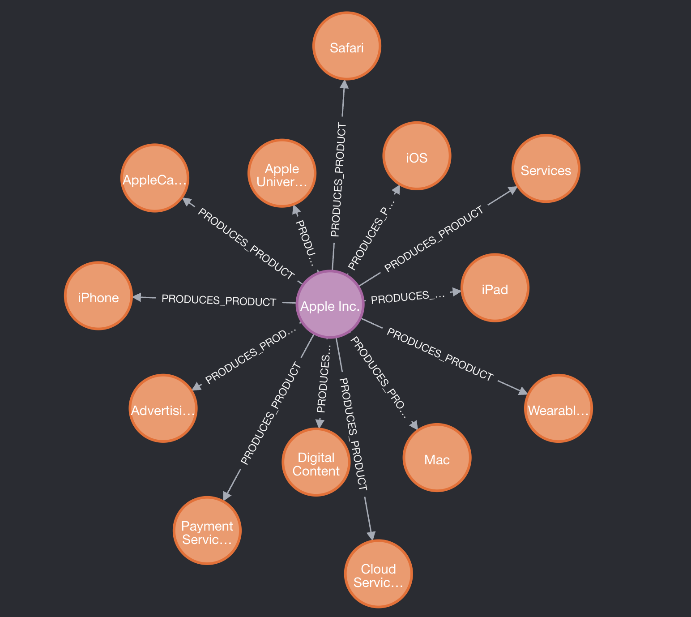
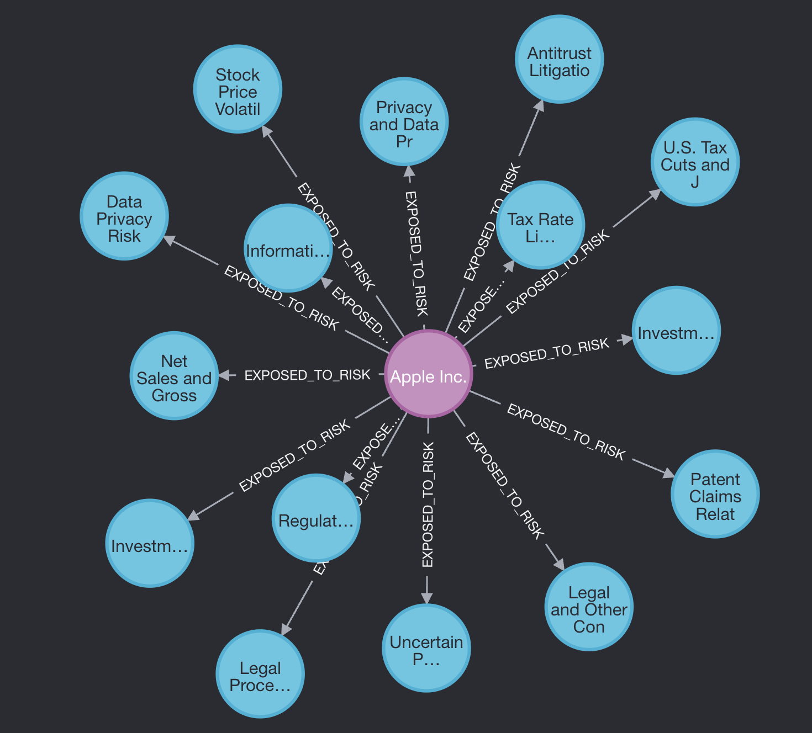
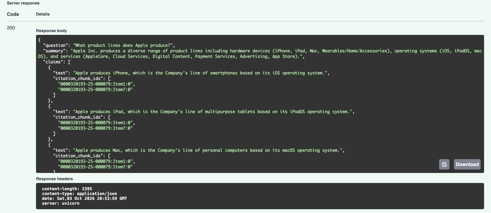

# SEC GraphRAG

Hybrid **knowledge-graph + vector RAG** over SEC **10-K** filings. Closed ontology in Neo4j, the same chunks in pgvector, router picks graph and/or vectors, answers cite only chunks from that retrieval.

10 tickers, 44 hop-stratified questions. Three answer runs, with the planner, router, answer, and judge at temperature 0. Hybrid mean **0.86** (runs 0.856, 0.862, 0.862). Vector-only mean **0.89** (runs 0.878, 0.889, 0.889). The gap of those means is **−0.026**. The three paired gaps are **−0.033**, **−0.016**, and **−0.027**. Hybrid and vector both hit recall@5 **0.84** and MRR **0.70**. Vector still leads recall@10 (**0.94** vs **0.91**). Answer headline below is still the 2026-11-05 three-run table (full rebench not run yet).

## Results

44 questions. The score is an LLM judge against required facts. Out of scope means a correct refuse. Each cell is the mean of three runs. The range is the lowest and highest run.

| Hop / bucket | Hybrid | Vector-only | n |
|--------------|-------:|------------:|--:|
| Hop 0 (definitions) | **0.94** (0.94–0.94) | 0.88 (0.88–0.88) | 8 |
| Hop 1 (single edge) | 0.80 (0.79–0.80) | **0.81** (0.79–0.82) | 16 |
| Hop 2 (compare / multi-rel) | 0.82 (0.82–0.82) | **0.88** (0.88–0.88) | 8 |
| OOS (must refuse) | 0.92 (0.92–0.92) | **1.00** (1.00–1.00) | 12 |
| **Overall mean** | 0.86 (0.856–0.862) | **0.89** (0.878–0.889) | 44 |

Five items changed score across the three runs. On Apple products the hybrid answer text was identical, and the judge still scored it **1.0**, **1.0**, and **0.5**.

Retrieval is scored separately, on 32 answerable items. Out-of-scope items are skipped.

| | Recall@5 | Recall@10 | MRR |
|--|--------:|----------:|----:|
| Graph | 0.41 | 0.46 | 0.40 |
| Vector | **0.84** | **0.94** | **0.70** |
| Hybrid | **0.84** | 0.91 | **0.70** |

Hybrid alternates a vector chunk, then a graph chunk, and skips a chunk already used. Graph edges are ordered by how many question words they hit. Extraction confidence only breaks a tie. Both lists are retrieved even when the router said graph. Graph-only recall moves between runs because the planner does not return the same edges every time.

## Example

**Q:** What product lines does Apple produce? · route `graph` · `citations_valid`

> Apple produces hardware (iPhone, iPad, Mac, Wearables…), OSes, and services (AppleCare, Cloud Services, …).

Cites include `0000320193-25-000079:Item1:0`, `…:Item7:0`.

**Q:** What compute products does NVIDIA produce, and what geopolitical risks is it exposed to? · route `both`

> NVIDIA produces data-center / gaming GPUs (A100, H100, …) and faces geopolitical / export-control risk (e.g. China-related controls) among other exposures.

Cites include `0001045810-26-000021:Item1:0`, `…:Item1A:3`, …

<p align="center">
  
  
</p>
<p align="center">
  
</p>

## How the numbers were measured

Suite `multi_company_smoke` v4. The three answer runs are `benchmarks/results/multi_company_smoke_temp0_run1.json`, `run2`, and `run3`. The planner, router, answer, and judge were called at temperature 0.

**Judge calibration (rubric v1):** held-out linear weighted κ **0.84** (raw agreement 19/20). Two first-pass scores of 1.0 were wrong and were corrected: Meta AI competition is a 0, Meta AI glasses is a 0.5. Self-agreement on a later re-label is κ **0.42** (13/15). The older 24/24 sheet is history. [`benchmarks/calibration/RESULTS.md`](benchmarks/calibration/RESULTS.md).

The published gap is the difference of the two three-run means. The three paired gaps, hybrid minus vector-only on the same run, are −0.033, −0.016, and −0.027. `ablation_bootstrap.md` is an older pair and is not this gap.

CI fails if a committed hybrid recall@10 drops more than **0.02** from **0.917**. It reads the saved file and does not call a model.

Full tables: [`benchmarks/results/multi_company_smoke_temp0_run1.json`](benchmarks/results/multi_company_smoke_temp0_run1.json), [`run2`](benchmarks/results/multi_company_smoke_temp0_run2.json), [`run3`](benchmarks/results/multi_company_smoke_temp0_run3.json), [`benchmarks/results/retrieval_v4.md`](benchmarks/results/retrieval_v4.md).

### 60-second pass

1. The generation gap of the three-run means is −0.026. All three paired gaps are negative. That range is three runs, not a bootstrap interval.
2. One graph question: `python answer.py "What product lines does Apple produce?" --ticker AAPL`.
3. One refusal: a question the 10-K corpus cannot answer (Tesla battery supply, Bitcoin on Apple's balance sheet).
4. One open miss: Netflix “AI compute for others” denies the premise in prose but leaves `refused` false. See **What didn't work**.

## Design decisions

Locked during the eval phase. Retrieval and generation are separate scores. A high answer with the wrong gold chunk is still a retrieval miss. The judge grades required facts, not a paragraph match to the gold line. Reported κ is the hold-out, not the 24/24 debug sheet. The ablation is hybrid versus vector-only, and the range across the three runs is part of the claim.

The system constraints that came first: six entity types and eight relationship types, Cypher only from allowlisted templates, and a citation must be in this retrieval's chunk allowlist.

## What didn't work

These are hybrid answers whose three-run mean is below 1.0. Detail is in [`docs/PROBLEMS_AND_FIXES.md`](docs/PROBLEMS_AND_FIXES.md).

| Item | Mean | Runs | What happened |
|------|-----:|------|----------------|
| `oos_nflx_ai_compute_for_others` | 0.00 | 0, 0, 0 | Denied the premise in prose but did not set refused |
| `hop1_msft_products` | 0.13 | 0.13, 0.13, 0.13 | Named Microsoft 365, Dynamics, Windows, and Bing. Missed Azure and Xbox |
| `hop2_nvda_auto_competitors_risks` | 0.42 | 0.42, 0.42, 0.42 | Auto SoCs. Missed DRIVE / autonomous |
| `hop0_meta_ai_glasses` | 0.50 | 0.50, 0.50, 0.50 | Reality Labs and Quest. No Ray-Ban Meta / Oakley Meta |
| `hop2_jpm_credit_vs_market` | 0.63 | 0.63, 0.63, 0.63 | Both risks named. Older runs of this item scored 0.38 and 1.0 |
| `hop1_aapl_products` | 0.83 | 1.0, 1.0, 0.5 | The answer text is the same on all three runs. The judge moved |
| `hop1_meta_apps` | 0.83 | 0.75, 0.75, 1.0 | Names Family of Apps and Reality Labs. No longer a refusal |

`hop1_meta_ai_competition` was **0.00** on all three published runs (Apple/Google ad limits, no TikTok). After those runs, a retrieve fix (larger over-fetch + named-rival boost) and an answer-window fix (center on TikTok / keep `AI` needles) raised a one-item resmoke to **0.875** hybrid and vector. That score is **not** folded into the table above. Detail: [`docs/PROBLEMS_AND_FIXES.md`](docs/PROBLEMS_AND_FIXES.md) §16–§17.

Earlier failures that are fixed, and worth saying anyway: keyword overlap scored wrong answers as 1.0, a 1200-character window hid AppleCare and Azure, and an Apple product answer cited Meta's 10-K.

---

## Why this exists

| Problem | Approach here |
|---------|----------------|
| Embeddings alone blur *relationships* (who competes with whom, what risks attach to which issuer) | Graph path over a fixed ontology + parameterized Cypher templates |
| LLMs invent citations | Every claim’s `chunk_id` must appear in *this* retrieval’s allowlist (else reject / regenerate) |
| Multi-company graphs silently merge the wrong nodes | Ticker-scoped risks/products/execs; shared companies keep `home_ticker` + `tickers[]` |
| Cross-filing extract invents edges on global companies (e.g. Meta→`APPLE` products) | Issuer-owned write gate + retrieve-time chunk ticker filter on graph evidence |
| “RAG demos” skip measurement | Hop-stratified **hybrid vs vector-only** suite with LLM-as-judge (keyword secondary) |

---

## Architecture

```text
10-K Items 1 / 1A / 7
  → chunk + content-hash cache
  → Claude + Instructor → closed ontology JSON
  → entity resolution → Neo4j MERGE (edges carry source_chunk_ids)
  → same chunks → OpenAI embeddings → pgvector (shared chunk_id)

Question → Haiku router (graph | vector | both)
  → graph: allowlisted Cypher templates only (multi-template for hop-2)
  → vector: HNSW top-k
  → grounded answer + citation validation → FastAPI POST /ask
```

**Ontology (6 / 8):** Company, Subsidiary, Supplier, ProductLine, RiskFactor, Executive · OWNS_SUBSIDIARY, SUPPLIED_BY, COMPETES_WITH, EXPOSED_TO_RISK, PRODUCES_PRODUCT, DEPENDS_ON, LED_BY, OPERATES_IN_SEGMENT

---

## Quick start

```bash
docker compose up -d
python -m venv .venv && source .venv/bin/activate   # Windows: .venv\Scripts\activate
pip install -r requirements.txt
cp .env.example .env   # add ANTHROPIC_API_KEY + OPENAI_API_KEY
```

**Ask (needs a built local corpus — your Docker volumes + `data/` caches):**

```bash
python answer.py "What product lines does Apple produce?" --ticker AAPL
python answer.py "What is AppleCare?" --ticker AAPL

python -m uvicorn api:app --host 127.0.0.1 --port 8000
# POST http://127.0.0.1:8000/ask
# {"question":"What product lines does Apple produce?","ticker":"AAPL"}
```

**Grow corpus (paid — always budget first):**

```bash
python grow_corpus.py MSFT JPM --budget
python grow_corpus.py MSFT JPM --confirm --max-chunks 5   # cheap smoke
```

**Benchmark (paid answer run; judge is cheaper Haiku):**

```bash
python benchmark_runner.py --suite benchmarks/multi_company_smoke.json --limit 2
python benchmark_runner.py --suite benchmarks/multi_company_smoke.json --confirm
# Re-score saved answers with LLM judge (no answer re-run):
python benchmark_runner.py --suite benchmarks/multi_company_smoke.json \
  --rejudge benchmarks/results/multi_company_smoke_full_rebench.json --confirm
```

Neo4j Browser: http://localhost:7474 (`neo4j` / `password` by default) · API docs: http://127.0.0.1:8000/docs

---

## Repo map

| Area | Files |
|------|--------|
| Ingest / extract / resolve / write | `ingest.py`, `extractor.py`, `resolver.py`, `graph_writer.py` |
| Vectors | `embedder.py`, `vector_db.py` |
| Retrieve / answer / API | `router.py`, `graph_retriever.py`, `vector_retriever.py`, `answer.py`, `api.py` |
| Batch growth / budget | `grow_corpus.py`, `budget.py` |
| Eval | `benchmarks/`, `benchmark_runner.py`, `benchmark_judge.py`, `chunk_ticker.py` |
| Failure log | [`docs/PROBLEMS_AND_FIXES.md`](docs/PROBLEMS_AND_FIXES.md) — bugs we hit and how we fixed them |
| Internal build notes | [`docs/dev-notes/`](docs/dev-notes/) (curriculum handoff; not required to use the system) |

