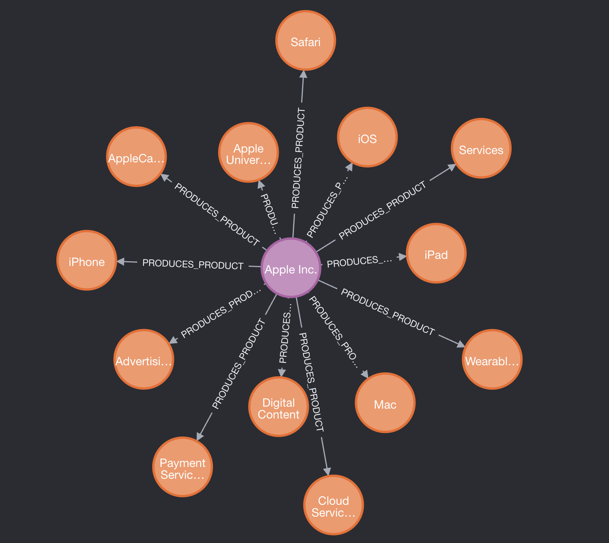
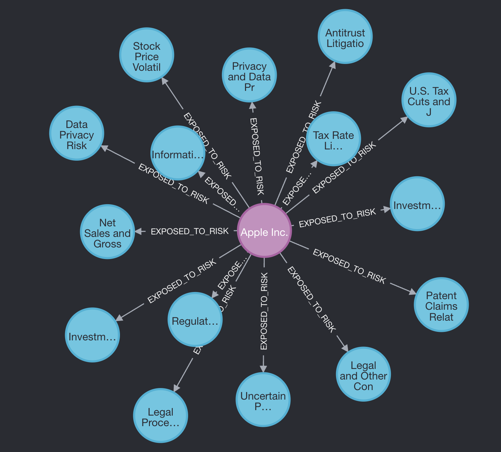
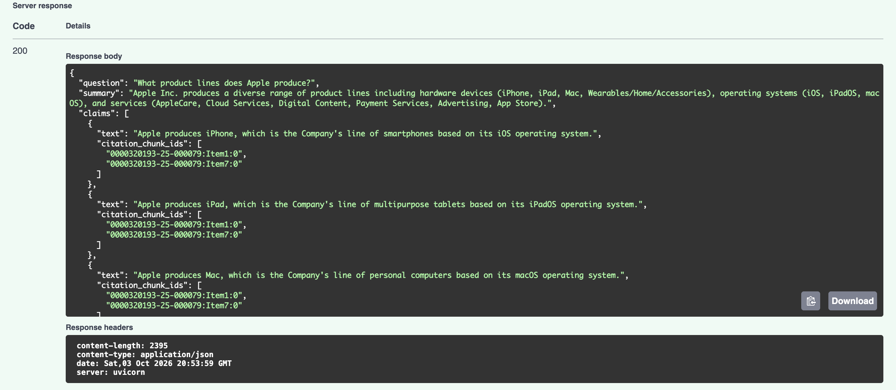

# SEC GraphRAG

**Live demo: [sec-graph-rag.vercel.app](https://sec-graph-rag.vercel.app)**. It plays saved runs and makes no model calls.

Question answering over ten companies' 10-K filings that combines a **knowledge graph** (for relationships like *who competes with whom* or *which risks attach to which company*) with **vector search** (for everything else). Every answer cites the exact filing passages it came from, and citations to anything that wasn't retrieved are rejected.

On 44 hop-stratified questions, hybrid and vector-only **tie**: three temperature-0 runs average **0.96** vs **0.94**, and the paired bootstrap 95% interval on the gap includes zero overall and on every hop. An earlier "hop-2 win" (1.00 vs 0.88, interval above zero) did not survive an audit of the eval: the LLM judge marked real products newer than its training data as invented, and Apple had two fiscal years of filings in the index. Both are fixed, and every number here is from the re-run. Retrieval also ties (recall@10 0.93 vs 0.94). The judge's held-out κ against hand labels is **0.79**.

The [demo](#demo) is a Next.js page, [hosted here](https://sec-graph-rag.vercel.app). One question fills in as a trace: the route, the graph edges, the filing passages, the answer, and the citation check. Saved runs play with the API off.

Companies: AAPL, META, MSFT, NVDA, GOOGL, AMZN, JPM, NFLX, XOM, JNJ.

## Results

44 questions, one pinned 10-K per company. The score is an LLM judge against required facts, reading the passages each answer cites. Out of scope means a correct refuse. Cells are the **mean of three** temperature-0 runs ([`three_run_means_p7.md`](benchmarks/results/three_run_means_p7.md)).

| Hop / bucket | Hybrid | Vector-only | Gap (95% CI) | n |
|--------------|-------:|------------:|--------------|--:|
| Hop 0 (definitions) | 1.00 | 1.00 | 0.000 | 8 |
| Hop 1 (single edge) | 0.91 | 0.87 | +0.049 (−0.14 – +0.26) | 16 |
| Hop 2 (compare / multi-rel) | 0.94 | 0.96 | −0.021 (−0.17 – +0.08) | 8 |
| OOS (must refuse) | 1.00 | 1.00 | 0.000 | 12 |
| **Overall (mean of runs)** | **0.96** | **0.94** | +0.014 (−0.06 – +0.09) | 44 |

No gap is significant. The tie hides a split, though: on a few questions one system wins in every run. Hybrid wins "Does Apple compete with Meta?" through a cross-company graph edge, and names Waymo where vector-only does not. Vector-only wins Microsoft's product lines, Microsoft cloud + geopolitical risk, and Netflix–AWS, where the graph route returned an incomplete list. The [Results page](https://sec-graph-rag.vercel.app/results#side-by-side) shows one each way. Bootstrap: [`ablation_bootstrap_p7.md`](benchmarks/results/ablation_bootstrap_p7.md).

Retrieval is scored separately, on 32 answerable items. Out-of-scope items are skipped.

| | Recall@5 | Recall@10 | MRR |
|--|--------:|----------:|----:|
| Graph | 0.43 | 0.51 | 0.38 |
| Vector | 0.84 | **0.94** | **0.70** |
| Hybrid | **0.85** | 0.93 | 0.68 |

The graph adds little to *finding* the right passage: vector search already does that well. What it does add is explicit, citable edges (company → competitor, company → risk), which is why it wins the questions that turn on one relationship. It does not beat vector-only on this suite overall.

## Architecture

```text
10-K Items 1 / 1A / 7
  → chunk + content-hash cache
  → Claude + Instructor → closed ontology JSON
  → entity resolution → Neo4j MERGE (edges carry source_chunk_ids)
  → same chunks → OpenAI embeddings → pgvector (shared chunk_id)

Question → Haiku router (graph | vector | both)
  → graph: allowlisted Cypher templates only (multi-template for hop-2)
  → vector: HNSW top-k
  → grounded answer + citation validation → FastAPI POST /ask
  → Next.js demo reads the trace on that response
```

**Ontology (6 / 8):** Company, Subsidiary, Supplier, ProductLine, RiskFactor, Executive · OWNS_SUBSIDIARY, SUPPLIED_BY, COMPETES_WITH, EXPOSED_TO_RISK, PRODUCES_PRODUCT, DEPENDS_ON, LED_BY, OPERATES_IN_SEGMENT

Both stores share the same `chunk_id`, so a graph edge always points back to the passage it was extracted from, and graph and vector evidence can be merged and cited the same way.

## Example

**Q:** What product lines does Apple produce? · route `graph` · `citations_valid`

> Apple produces hardware (iPhone, iPad, Mac, Wearables…), OSes, and services (AppleCare, Cloud Services, …).

Cites include `0000320193-25-000079:Item1:0`, `…:Item7:0`.

**Q:** What compute products does NVIDIA produce, and what geopolitical risks is it exposed to? · route `both`

> NVIDIA produces data-center / gaming GPUs (A100, H100, …) and faces geopolitical / export-control risk (e.g. China-related controls) among other exposures.

Cites include `0001045810-26-000021:Item1:0`, `…:Item1A:3`, …

<p align="center">
  
  
</p>
<p align="center">
  
</p>

## How the numbers were measured

Suite `multi_company_smoke` v4: 44 questions across the ten companies, stratified by hop count (definitions, single relationship, multi-relationship comparisons) plus out-of-scope questions the system must refuse. Each answerable question has gold chunk IDs for retrieval scoring and required facts for answer scoring.

**Corpus:** one 10-K per company, pinned in [`pinned_filings.py`](pinned_filings.py) to the filing the gold answers were written against. Ingest fetches that filing, not the latest. Vector search and graph facts drop chunks from any other filing.

Generation headline: mean of three temperature-0 runs, produced by [`rerun_pinned_benchmark.sh`](rerun_pinned_benchmark.sh):

- [`multi_company_smoke_temp0_p7.json`](benchmarks/results/multi_company_smoke_temp0_p7.json)
- [`multi_company_smoke_temp0_p7_run2.json`](benchmarks/results/multi_company_smoke_temp0_p7_run2.json)
- [`multi_company_smoke_temp0_p7_run3.json`](benchmarks/results/multi_company_smoke_temp0_p7_run3.json)

Summary: [`three_run_means_p7.md`](benchmarks/results/three_run_means_p7.md). Bootstrap on per-item three-run means: [`ablation_bootstrap_p7.md`](benchmarks/results/ablation_bootstrap_p7.md). The superseded p6 runs (hybrid 0.93 vs 0.90, judge rubric v1, mixed Apple filings) stay in `benchmarks/results/` for comparison.

**Judge (rubric v2):** the judge sees the full text of every cited chunk and lists the claims it doubts, marking each as supported by a cited passage or not. Code, not the judge, applies the hallucination cap, and a supported claim never triggers it. Held-out linear weighted κ against hand labels is **0.79** (raw agreement 19/20; the miss is Meta AI glasses, labeled 0.5 and judged 1.0). It was measured by re-judging the same saved answers the labels were written against ([`kappa_rubric_v2.txt`](benchmarks/results/kappa_rubric_v2.txt)). Rubric v1 scored 0.84 on the same sheet, but v1 used the judge's own knowledge. Two hold-out labels were corrected after seeing judge scores, so treat κ as a calibration check, not a fully blind panel. Self-agreement on a later re-label is κ **0.42** (13/15). [`benchmarks/calibration/RESULTS.md`](benchmarks/calibration/RESULTS.md).

**CI gate:** fails if the committed hybrid recall@10 drops more than **0.02** from **0.927**. It reads the saved results file and does not call a model, so it costs nothing to run. A manual `workflow_dispatch` with `break=true` zeroes one saved hit to show the gate failing. Retrieval tables: [`benchmarks/results/retrieval_p7.md`](benchmarks/results/retrieval_p7.md).

### 60-second pass

1. Generation: three-run hybrid **0.96** vs vector **0.94**; every gap's CI includes zero. The earlier hop-2 win was two bugs (see **What didn't work**).
2. One graph question: `python answer.py "What product lines does Apple produce?" --ticker AAPL`. Or open the [demo](#demo) and click Apple products. That saved run does not call a model.
3. One refusal: a question the 10-K corpus cannot answer (Tesla battery supply, Bitcoin on Apple's balance sheet).
4. Misses still open: Microsoft products and cloud + risk on the graph route, Netflix–AWS. See **What didn't work**.

## Design decisions

| Decision | Why | What it costs |
|----------|-----|---------------|
| **Closed ontology** (6 entity / 8 relationship types) instead of open extraction | Clean, queryable graph; entity resolution stays tractable; edges are comparable across companies | Anything outside the 6/8 types is invisible to the graph and falls back to vector search |
| **Allowlisted Cypher templates** instead of model-written Cypher | No injection or runaway queries; every graph query is reviewable and testable | Coverage is limited to the question shapes the templates support; new shapes need a new template |
| **Citation allowlist**: every cited `chunk_id` must come from this retrieval, else reject / regenerate | Stops invented sources; makes every claim traceable to a filing passage | Can't catch a real chunk cited for the wrong claim; regeneration adds latency and cost |
| **Ticker-scoped writes and retrieval** (`home_ticker` + `tickers[]` on shared companies) | Prevents cross-filing leaks — e.g. Meta's 10-K inventing Apple product edges | Shared entities need extra bookkeeping; global relationships are harder to express |
| **Cheap Haiku router** (graph / vector / both) | Low cost per question; most questions don't need the graph | Sometimes routes wrong — mitigated by retrieving both lists even when the router says graph |
| **Hybrid merge**: alternate a vector chunk, then a graph chunk, skipping chunks already used; graph edges ordered by question-word hits, extraction confidence only as a tie-break | Keeps the strong vector ranking while making room for graph evidence | Graph-only recall varies between runs because the planner does not return the same edges every time |
| **Separate retrieval and generation scores** | A good answer built on the wrong passage is still a retrieval miss; tells you which half failed | Needs gold chunk IDs per question, which are labeled by hand |
| **Judge grades required facts**, not similarity to a gold answer | Rewards correct content in any wording | Requires writing required facts per question; scores are only as good as those fact lists |
| **Judge reads the cited passages**; code applies the hallucination cap | A claim the filing supports can't be penalized because the judge model hasn't heard of it | About 12k input tokens per judge call (about $0.015 with Haiku 4.5) |
| **One pinned 10-K per company** | Gold answers match the filing being searched; scores stay comparable over time | Newer filings are ignored until a deliberate suite update moves the pin and the gold answers together |

## What didn't work

**The hop-2 result was an eval bug, twice over.** The published headline was hybrid 1.00 vs 0.88 on hop-2, with an interval above zero. An audit found two problems.

1. **The judge used its own knowledge.** On "What hardware and services does Apple produce?", it capped vector-only at 0.5 for naming iPhone 17e, iPhone Air and MacBook Neo as "non-existent products". All three are in Apple's fiscal 2026 10-K, which shipped after the judge model's training data. Fix: the judge now reads every cited passage, and a claim a passage supports can't be counted as invented.
2. **Apple had two filings in the index.** Ingest took "the latest 10-K", and restoring Apple after Nov 3, 2026 added fiscal 2026 next to fiscal 2025, which the gold answers were written against. Fix: one pinned filing per company, enforced at ingest and at retrieval.

After both fixes and a full re-run, hop-2 is 0.94 vs 0.96 and nothing is significant. Removing the Apple penalty alone already pulled the old interval's lower bound to 0.000.

Questions hybrid still misses (three-run mean below 1.0):

| Item | 3-run hybrid | 3-run vector | What happened |
|------|-------------:|-------------:|----------------|
| `hop1_msft_products` | 0.13 | 0.88 | Graph route listed Microsoft 365, Dynamics, Windows, Bing; no Azure or Xbox |
| `hop2_msft_cloud_and_geo_risk` | 0.50 | 1.00 | Says "cloud computing" but never names Azure or datacenter infrastructure |
| `hop1_nflx_aws_relationship` | 0.50 | 1.00 | Gets AWS as a supplier; misses that Amazon's retail side also competes |

Judge issues still open: in 2 of 189 judged answers the judge's own reasoning disagrees with its score. Waymo vector-only got 0.13, but its reasoning says one of two facts was covered. Microsoft cloud vs. personal, vector-only run 1, was capped as a hallucination while the reasoning says "well-supported". The judge's list of doubted claims is not saved in the results yet, so that cap can't be audited.

Earlier systems bugs worth saying anyway: keyword overlap scored wrong answers as 1.0 (which is why the judge grades required facts now), a 1200-character window hid AppleCare and Azure, and an Apple product answer once cited Meta's 10-K (which led to the ticker-scoped write gate).

## Quick start

```bash
docker compose up -d
python -m venv .venv && source .venv/bin/activate   # Windows: .venv\Scripts\activate
pip install -r requirements.txt
cp .env.example .env   # add ANTHROPIC_API_KEY + OPENAI_API_KEY (+ USER_AGENT_EMAIL for SEC EDGAR)
```

**Build a small corpus from scratch** (paid — always check the estimate first):

```bash
python grow_corpus.py AAPL --budget                     # estimate only, no spend
python grow_corpus.py AAPL --confirm --max-chunks 5     # cheap smoke: ingest → extract → Neo4j → pgvector
python grow_corpus.py AAPL --confirm                    # full Items 1 / 1A / 7
```

`--max-total-usd 20` aborts before any spend if the aggregate estimate is higher. Add more tickers in one run (`python grow_corpus.py AAPL MSFT NVDA --budget`).

**Ask:**

```bash
python answer.py "What product lines does Apple produce?" --ticker AAPL
python answer.py "What is AppleCare?" --ticker AAPL
python answer.py "What product lines does Apple produce?" --ticker AAPL --vector-only   # baseline

python -m uvicorn api:app --host 127.0.0.1 --port 8000
# POST http://127.0.0.1:8000/ask
# {"question":"What product lines does Apple produce?","ticker":"AAPL"}
```

The browser version of that same call is the [demo](#demo).

## Demo

[`web/`](web/) is a Next.js app. Ask a question, or click a sample, and the page shows what this retrieval did:

1. **Route** — `graph`, `vector`, or `both`, with the router’s confidence and rationale.
2. **Graph** — the edges that came back, and the chunk ids on them.
3. **Filings** — the vector passages, with section and score.
4. **Answer** — the summary and each claim, linked to its chunk ids.
5. **Check** — whether every citation was in this retrieval’s allowlist, and whether the model refused.

`POST /ask` returns that trace. The answer is still produced in `answer.py`. The page does not run retrieval itself.

Three saved runs ship in [`web/fixtures/`](web/fixtures/). They are real `POST /ask` responses, labeled as saved runs. They play with no model call, and a matching one plays if the local API is down.

| Run | Question | What it shows |
|-----|----------|----------------|
| Apple products | What product lines does Apple produce? | route `graph` |
| NVIDIA products and risks | What compute products does NVIDIA produce, and what geopolitical risks is it exposed to? | route `both` |
| Bitcoin on Apple’s balance sheet | How many Bitcoin does Apple hold on its balance sheet? | refusal |

```bash
cd web && npm install && npm run dev
```

Open http://localhost:3000. Choose **Saved runs** for the table above. A live ask also needs the API on port 8000 (`python -m uvicorn api:app --host 127.0.0.1 --port 8000`), plus Docker, a built corpus, and the keys in `.env`.

**Hosted copy.** [sec-graph-rag.vercel.app](https://sec-graph-rag.vercel.app) is a Vercel build that plays the three saved runs only. It never calls the API, so it costs nothing in model calls. To deploy, import the repo in Vercel and set Root Directory to `web`. Nothing else needs setting. `SAVED_RUNS_ONLY=1` gives the same build anywhere else, and `SAVED_RUNS_ONLY=0` turns it off.

Other pages: **Results** is the hop table above. **How it works** is the pipeline and the closed ontology.

Regenerate the TypeScript types after changing `AskResponse`:

```bash
.venv/bin/python -c "import json; from api import app; json.dump(app.openapi(), open('web/openapi.json','w'), indent=2)"
cd web && npm run generate:types
```

**Benchmark** (paid answer run; the judge is the cheaper Haiku). The full suite needs all ten companies in the corpus:

```bash
python benchmark_runner.py --suite benchmarks/multi_company_smoke.json --limit 2
python benchmark_runner.py --suite benchmarks/multi_company_smoke.json --confirm
# Re-score saved answers with LLM judge (no answer re-run):
python benchmark_runner.py --suite benchmarks/multi_company_smoke.json \
  --rejudge benchmarks/results/multi_company_smoke_temp0_p6_run3.json --confirm
```

Neo4j Browser: http://localhost:7474 (`neo4j` / `password` by default) · API docs: http://127.0.0.1:8000/docs

## Repo map

| Area | Files |
|------|--------|
| Ingest / extract / resolve / write | `ingest.py`, `extractor.py`, `resolver.py`, `graph_writer.py` |
| Vectors | `embedder.py`, `vector_db.py` |
| Retrieve / answer / API | `router.py`, `graph_retriever.py`, `vector_retriever.py`, `answer.py`, `api.py` |
| Demo UI | `web/` — Next.js ask page, results, and how-it-works |
| Batch growth / budget | `grow_corpus.py`, `budget.py` |
| Eval | `benchmarks/`, `benchmark_runner.py`, `benchmark_judge.py`, `retrieval_benchmark.py`, `retrieval_metrics.py`, `bootstrap_ci.py`, `calibration_metrics.py`, `recall_gate.py` |
| Tests | `test_*.py` |
| Failure log | [`docs/PROBLEMS_AND_FIXES.md`](docs/PROBLEMS_AND_FIXES.md) — bugs hit and how they were fixed |
| License | [`LICENSE`](LICENSE) (MIT) |
